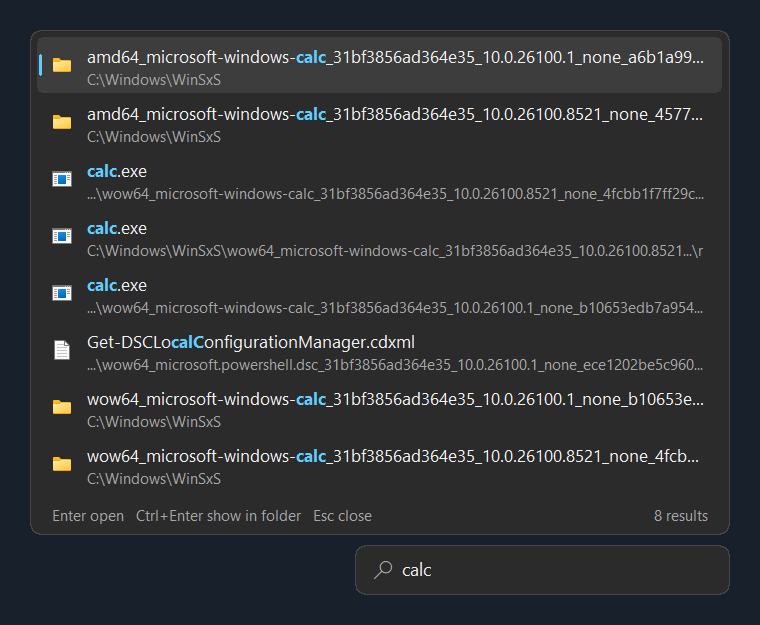
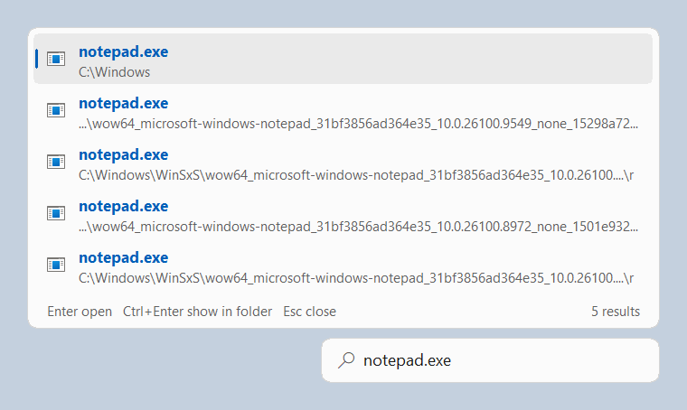

# evbar

A compact, rounded search box that floats just above the Windows taskbar tray and searches
[Voidtools Everything](https://www.voidtools.com/) as you type. It talks to the running Everything
process directly over Everything's `WM_COPYDATA` IPC. It doesn't use the Everything SDK DLL, doesn't
scan the disk, and has no runtime dependencies. It's one 190 KB executable.




## Features

- **Instant results.** Every keystroke sends a query. A worker thread always sends the newest query
  and drops older ones, and replies to superseded queries are ignored by reply id, so typing never
  queues work or blocks the UI.
- **Sits above the tray.** Right-aligned with the notification area and floating just above the taskbar.
  It follows the taskbar to any edge and repositions on display, DPI, and work-area changes, and when Explorer restarts.
- **Native Win32 UI.** Rounded corners (DWM on Windows 11, a window region on Windows 10), a
  double-buffered dropdown, Everything's match highlighting, shell icons by file type, light and dark
  themes that follow the system, and PerMonitorV2 DPI awareness.
- **Out of sight until you need it.** `Win+Alt+Space` (configurable) pops the box up above the tray.
  `Esc`, opening a result, clicking elsewhere, or the hotkey again puts it away.
- **Or pinned.** With `--pinned` it stays on screen above the tray and hides only while a fullscreen
  app is in front, like the taskbar does.
- Works with Everything 1.4, and with Everything 1.5 alpha (instance `1.5a`).

| Key | Action |
| --- | --- |
| `Win+Alt+Space` | Show or hide the search box (change it with `--hotkey`) |
| `Up` / `Down`, `PgUp` / `PgDn` | Move the selection |
| `Enter` | Open the selected item |
| `Ctrl+Enter` | Show it in Explorer |
| `Esc` | Hide the box (pinned mode: close results, then clear the text, then return focus to the taskbar) |
| `Ctrl+Backspace` | Delete the previous word |
| Right-click the box | Exit |

## Install

1. Install and run [Everything](https://www.voidtools.com/). evbar only queries it.
2. Download `evbar.exe` from the [latest release](https://github.com/NikhilBhatt-15/evbar/releases/latest)
   and run it. Check the SHA-256 against the release notes if you like.
3. To start evbar at sign-in, put a shortcut to `evbar.exe --hidden` in `shell:startup`.

Run normally, evbar pops up once so you can see it started. With `--hidden` it starts silently and
waits for the hotkey.

Options:

```text
evbar.exe --hidden            start without popping up (for autostart)
evbar.exe --pinned            keep the box on screen above the tray instead of hiding it
evbar.exe --hotkey <combo>    global hotkey, e.g. Ctrl+Shift+Space, Win+Shift+F, Alt+F12 (default Win+Alt+Space)
evbar.exe --instance <name>   target a named Everything instance (default: the 1.4 instance, then "1.5a")
evbar.exe --theme light|dark  override the system theme
```

Global hotkeys go to whichever app registers them first. If another app already owns your combo, evbar
says so at startup, so pick another one. For example, the Claude desktop app uses `Ctrl+Alt+Space`.
Combos are built from `Ctrl`, `Alt`, `Shift`, `Win` plus a letter, a digit, `F1`–`F24`, `Space`, or a
few named keys. To keep a custom hotkey, put it in the shortcut's target, e.g.
`"C:\Tools\evbar.exe" --hotkey Ctrl+Shift+Space`.

Running `evbar.exe` again while it's already running focuses the running copy.

## Build

Requires Rust (MSVC toolchain) on Windows.

```text
cargo build --release          # target\release\evbar.exe
cargo test                     # protocol unit tests and a WM_COPYDATA round trip against a mock
```

To try evbar without installing Everything, run the mock server. It indexes one directory and
serves the same IPC window. Don't run it while the real Everything is running, because both claim
the same window class.

```text
cargo run --release --example mock_everything -- C:\Windows 150000
```

`evbar.exe --render <query> <out.bmp>` runs one real query with the windows hidden, paints the box
and dropdown offscreen, and exits. That's how the screenshots above were made.

## How it works

### Everything's IPC protocol (SDK2 / `QUERY2`)

Everything owns a hidden top-level window of class `EVERYTHING_TASKBAR_NOTIFICATION`. A named
instance uses `EVERYTHING_TASKBAR_NOTIFICATION_(<name>)`. evbar finds it with `FindWindowW` and sends:

```text
WM_COPYDATA  wParam = evbar's window
             COPYDATASTRUCT.dwData = 18 (EVERYTHING_IPC_COPYDATA_QUERY2W)
             lpData = EVERYTHING_IPC_QUERY2

EVERYTHING_IPC_QUERY2                      (all DWORDs little-endian)
  +0x00  reply_hwnd                window that receives the answer
  +0x04  reply_copydata_message    reply id, echoed back as dwData
  +0x08  search_flags              1 match case, 2 whole word, 4 match path, 8 regex
  +0x0C  offset
  +0x10  max_results
  +0x14  request_flags             fields wanted per result (see below)
  +0x18  sort_type                 1 = name ascending, ...
  +0x1C  WCHAR search_string[]     NUL-terminated
```

Everything accepts the message, returns, and then sends `WM_COPYDATA` back to `reply_hwnd`. That reply has
`dwData = reply id` and an `EVERYTHING_IPC_LIST2` payload, answered from its in-memory index:

```text
EVERYTHING_IPC_LIST2
  +0x00  totitems        matches in the whole index
  +0x04  numitems        items in this reply
  +0x08  offset
  +0x0C  request_flags   fields actually present
  +0x10  sort_type
  +0x14  EVERYTHING_IPC_ITEM2 items[numitems] = { DWORD flags (1 folder, 2 drive); DWORD data_offset; }

  Item data starts at data_offset (from the start of the list). It holds one field per set bit of
  request_flags, in ascending bit order:
    strings  (0x1 name, 0x2 path, 0x4 full path, 0x2000 highlighted name, ...): DWORD len; WCHAR[len]; WCHAR 0
    0x10 size, 0x20/0x40/0x80/0x800/0x1000 dates: 8 bytes
    0x100 attributes, 0x400 run count: 4 bytes
```

Highlighted fields wrap matched text in `*`, and `**` is a literal asterisk. Version queries are plain
`SendMessage(hwnd, WM_USER, n, 0)` with `n` = 0 (major), 1 (minor), or 2 (revision).

evbar asks for name, path, and highlighted name, sorted by name, up to 100 results. The decoder in
[`src/ipc.rs`](src/ipc.rs) bounds-checks every field and returns `None` on malformed input rather than
panicking. Tests cover every truncation point.

### Threads

- **UI thread.** Owns the search box and the dropdown, and receives Everything's `WM_COPYDATA` replies directly.
  It accepts a reply only if `dwData` matches the newest query id.
- **IPC worker.** Waits on a single-slot mailbox and sends with `SendMessageTimeoutW(SMTO_ABORTIFHUNG)`.
  A hung Everything can't freeze the UI, and fast typing overwrites the slot instead of building a backlog.

### Placement

`SHAppBarMessage(ABM_GETTASKBARPOS)` gives the taskbar's rectangle and edge, and the
`Shell_TrayWnd` → `TrayNotifyWnd` window gives the tray. The box is a `WS_EX_TOOLWINDOW | WS_EX_TOPMOST`
popup whose right edge lines up with the tray, floating just above the taskbar. The dropdown is a
`WS_EX_NOACTIVATE` popup that opens away from the taskbar. evbar listens for `TaskbarCreated`,
`WM_SETTINGCHANGE`, `WM_DISPLAYCHANGE`, and `WM_DPICHANGED` to reposition.

## Background: how EverythingToolbar does it

evbar was designed after statically inspecting the shipped binaries of
[EverythingToolbar](https://github.com/srwi/EverythingToolbar) 3.5.0. The findings that shaped it:

- **Search transport.** EverythingToolbar P/Invokes the official SDK DLLs. With Everything 1.4 it
  uses `Everything64.dll` (SDK2), which sends the `QUERY2` `WM_COPYDATA` above. It runs it
  asynchronously: it creates a `STATIC` window parented to `HWND_MESSAGE`, subclasses its window procedure,
  passes it to `Everything_SetReplyWindow`, sets a fresh `Everything_SetReplyID` per query, and checks
  replies with `Everything_IsQueryReply`. With Everything 1.5 it prefers `Everything3.dll`
  (SDK3, a named-pipe client). evbar implements the SDK2 wire format itself.
- **Taskbar docking.** On Windows 10 it registers a real COM deskband (`IDeskBand2`, `IObjectWithSite`,
  `IInputObject`, added through `ITrayDeskband`). On Windows 11, which dropped deskbands, it restyles a
  WPF window as `WS_CHILD`, calls `SetParent` into `Shell_TrayWnd`, watches the taskbar with
  `SetWinEventHook(EVENT_OBJECT_LOCATIONCHANGE)`, and measures the free space between the taskbar
  buttons and the tray with UI Automation. evbar floats above the tray instead: that needs no
  reparenting into Explorer and no input-focus workarounds for a child of another process's window.
- **Focus and shortcuts.** It registers a global hotkey through NHotkey (`RegisterHotKey`). It can also replace
  Start-menu search: when `SearchHost.exe`/`SearchApp.exe` comes to the foreground, it installs a
  `WH_KEYBOARD_LL` hook on a dedicated thread, records the printable keys, closes the Start menu,
  opens its own window, and replays the keys with `keybd_event`. Bringing its window to the front
  uses `SetForegroundWindow` with an `AttachThreadInput` fallback. evbar uses the same fallback.

## License

MIT
